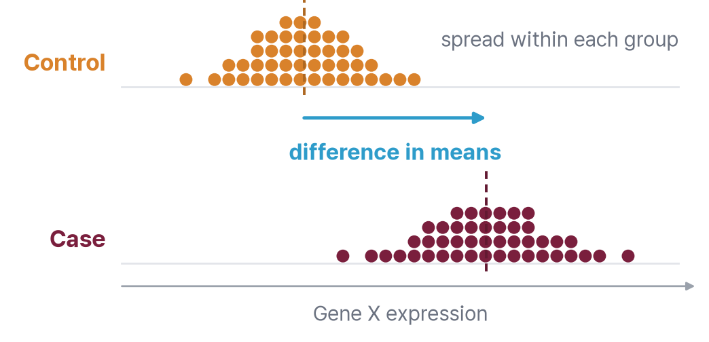
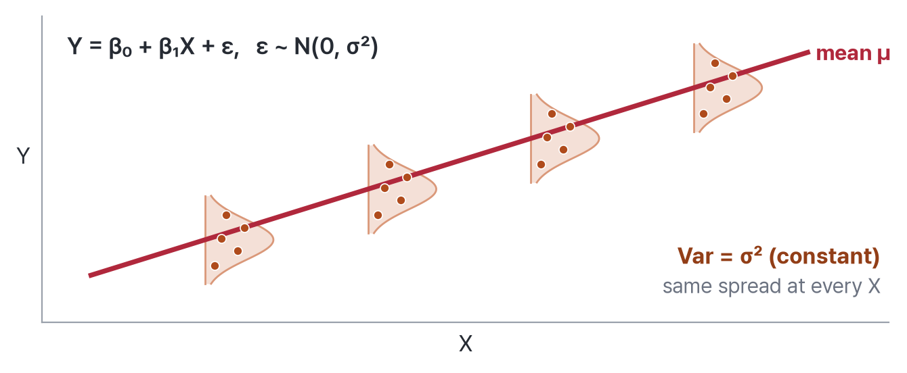
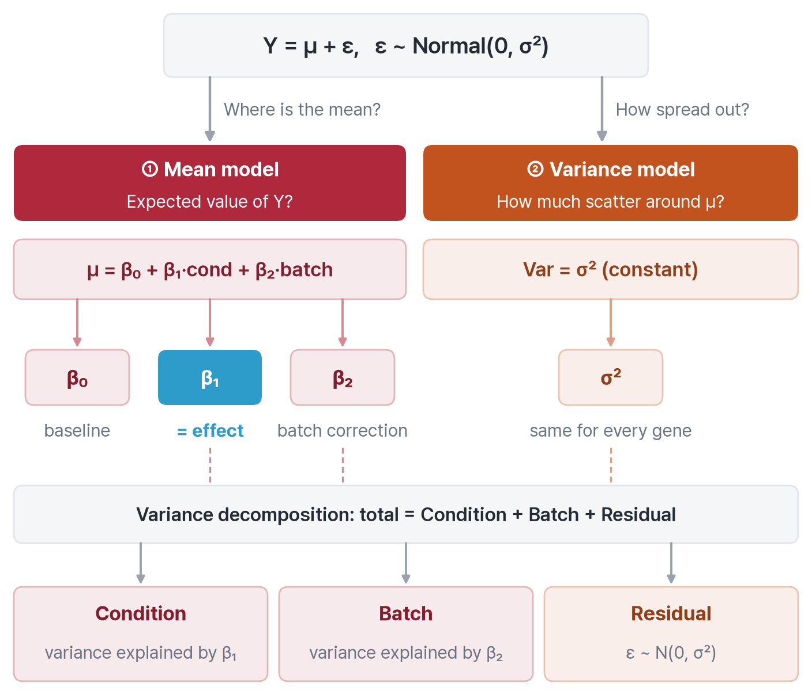
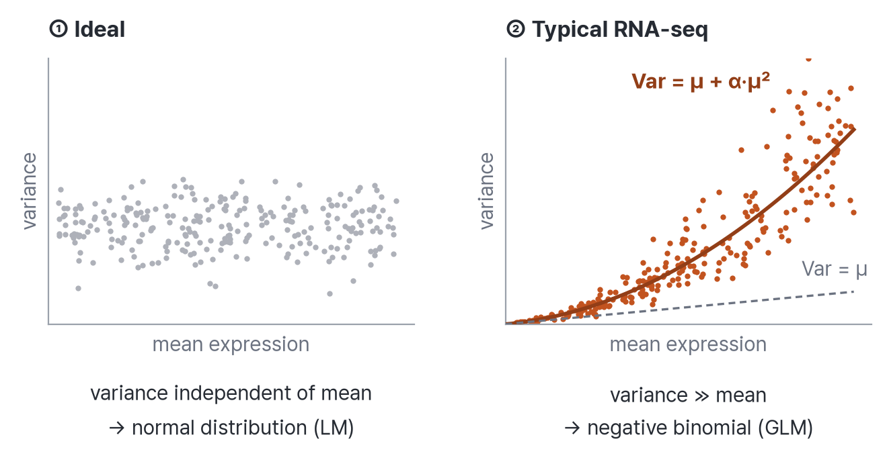
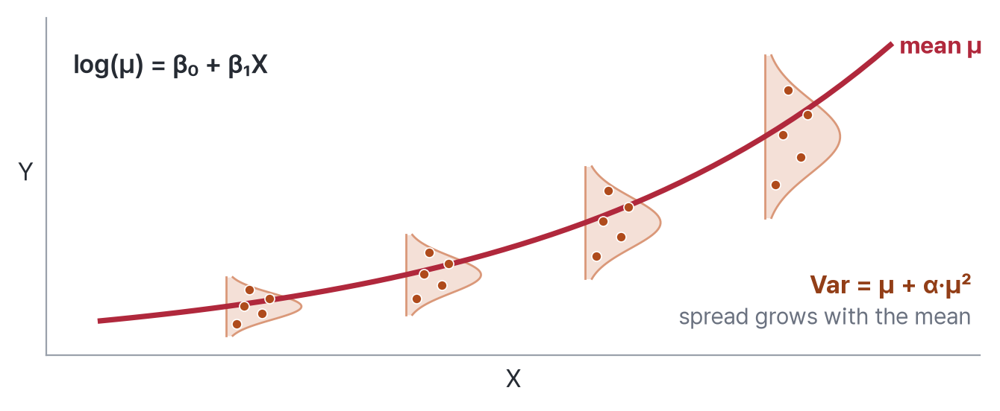
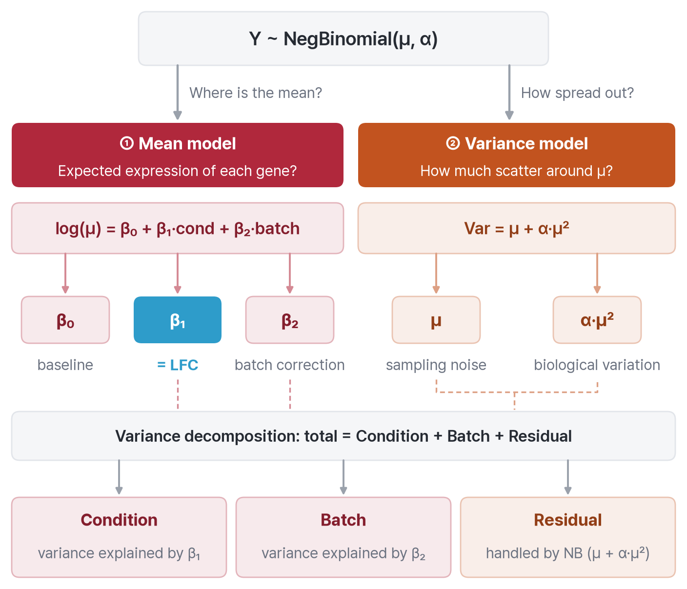
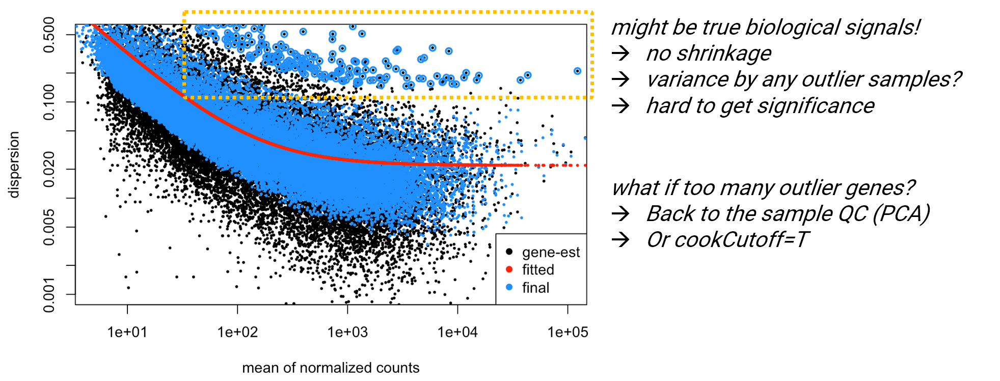
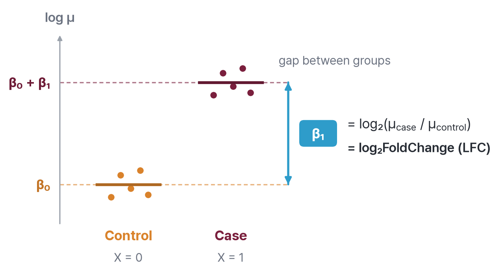
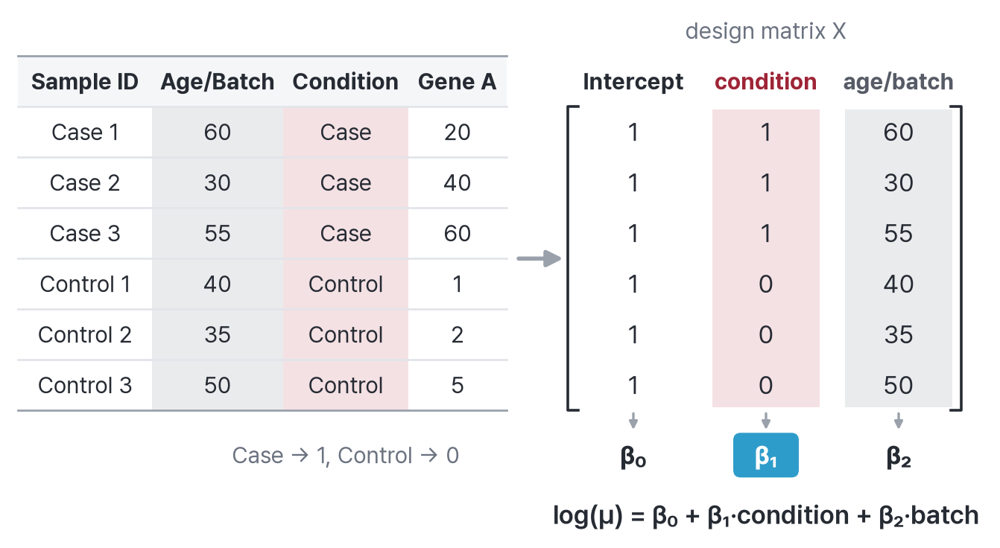

## 1. DEG (Differentially Expressed Genes)

> genes whose expression changes significantly between conditions (e.g., Case vs. Control)

{fig-align="center" width="460"}

-   **key challenge**: biological signal is always mixed with technical and inter-individual noise
-   **Ultimate goal**: [extract only the biological signal]{.underline} from the total observed variance

------------------------------------------------------------------------

## 2. Regression analysis

### 1) Linear regression

{fig-align="center"}

{fig-align="center"}

------------------------------------------------------------------------

### 2) Variance decomposition

> "Statistics is the process of tracing the source of variation."

$$
Total\ Variance = \mathbf{Condition} + \mathbf{Batch} + Residual
$$

-   **Condition (Signal)**: the true biological effect
-   **Batch (systematic noise)**: controllable noise from experiment date, instrument, operator, etc.
-   **Residual (random noise)**: unavoidable stochastic error

**Strategy**: include Batch in the statistical model to "[regress]{.underline} it [out]{.underline}" → the Condition signal is revealed

------------------------------------------------------------------------

## 3. Statistical Model of DESeq2

### 1) Characteristics of RNA-seq Data

-   **Count data**: discrete integers including zero
-   **Overdispersion**: variance \>\>\> mean → standard linear regression is not appropriate

{fig-align="center"}

------------------------------------------------------------------------

### 2) Negative Binomial Distribution

$$
Var(\mu) = \mu + \alpha\mu^2
$$

-   $\mu$: mean expression (intrinsic sampling error)
-   $\alpha\mu^2$: overdispersion (variation across biological replicates)

------------------------------------------------------------------------

### 3) GLM (Generalized Linear Model)

$$
\log(\mu) = \beta_0 + \beta_1(condition) + \beta_2(batch) + \cdots
$$

{fig-align="center"}

{fig-align="center"}

------------------------------------------------------------------------

### 4) Estimating Dispersion α (Shrinkage)

Addresses inaccurate per-gene α estimation in small samples (e.g., n=3):

1.  **Gene-wise**: calculate the raw dispersion for each gene
2.  **Trend line**: fit a global trend line across all genes
3.  **Shrink**: pull noisy estimates toward the trend line → improved accuracy, reduced false positives

{fig-align="center"}

------------------------------------------------------------------------

### 5) LFC Calculation and Statistical Testing

-   **β₁(condition)** = log₂FoldChange (case/control)
    -   Control: X=0 → log(μ_control) = β₀

    -   Case: X=1 → log(μ_case) = β₀ + β₁

        ∴ β₁ = log₂(μ_case / μ_control)
-   **Wald Test**: $z = \frac{\beta_1}{SE(\beta_1)}$ → p-value
-   **LRT (Likelihood Ratio Test)**: used for time-series or ≥3 group comparisons (χ²-based)

{fig-align="center"}

------------------------------------------------------------------------

## 4. Design Matrix

{fig-align="center"}

```{r}
#| eval: false

# design formula: batch/confounders first → condition last
# design = ~ Batch + Confounding + Condition

# How to set the reference level
# Option A: set in advance
dds$Condition <- relevel(dds$Condition, ref = "Control")

# Option B: specify post-hoc via contrast
results(dds, contrast = c("Condition", "Treatment", "Control"))
```

------------------------------------------------------------------------

### Design Matrix (Advanced)

| Analysis Type | Clinical Scenario | Design Formula |
|----|----|----|
| Paired sample | Tumor vs. Normal, Pre vs. Post | `~ Patient + Treatment` |
| Interaction Term | Drug response × disease subgroup | `~ Disease + Drug + Disease:Drug` |
| Time-Series | Multiple time points | `~ Time` (use LRT) |
| Random Effect | Multiple tissues from the same individual | Not supported in DESeq2 → use `limma-voom` |
| Hidden batch (sva) | Unmeasured technical/biological factors | `~ Age + Gender + SV1 + SV2 + Condition` |

------------------------------------------------------------------------

## 5. Practice

::: callout-note
## practice data download

save the following files in analysis/ in your R project

| File | Link |
|----|----|
| `dds_filtered.rds` | [📥 Download](https://drive.google.com/file/d/15OlQlqKIPGo9kDsx8Qk1BYTx4XGCnaiT/view?usp=drive_link) |
:::

```{r}
#| eval: false

library(DESeq2)
library(tidyverse)

dds <- readRDS('analysis/dds_filtered.rds')

# Run DESeq2 (paired model: ~ patient + condition)
dds <- DESeq(dds)
saveRDS(dds, file = 'analysis/dds_DESeq2.rds')

# Simple model (~ condition only)
dds@design <- as.formula('~ condition')
dds_smpl <- DESeq(dds)

# Check dispersion plots
plotDispEsts(dds)
plotDispEsts(dds_smpl)

# Extract results (specify contrast)
res <- results(dds, contrast = c("condition", "Tumor", "Normal"))
```

::: callout-note
### Collinearity

In a paired design, once patient ID is included in the model, variables such as age or gender cannot be added because they do not vary within a patient (nested structure) → **collinearity**
:::

------------------------------------------------------------------------

## 📝 W7 Assignment

#### 1. Visualizing Noise: Dispersion Plot

-   Generate dispersion plots for both using plotDispEsts().
-   Observe the distribution of the Blue dots (Final) and Blue circles (Outliers).

#### 2. The Design Matrix (Theory)

-   Run DESeq2 with the Design Matrix for the formula \~ patient + age_in_index + gender + condition.
-   Why can we not include Age or Gender in this specific matrix if patient ID is already present?
