<!-- 영문 원본: chapters/part1/W1_intro.qmd
     R 코드 블록은 CI(R 없음)에서도 렌더되도록 _freeze 결과(.cell/.cell-output)를 그대로 옮겼습니다.
     원본 코드가 바뀌면 이 블록도 함께 갱신하세요. -->

## 1. 소개

### 생물정보학(Bioinformatics)이란?

-   Bio + information

    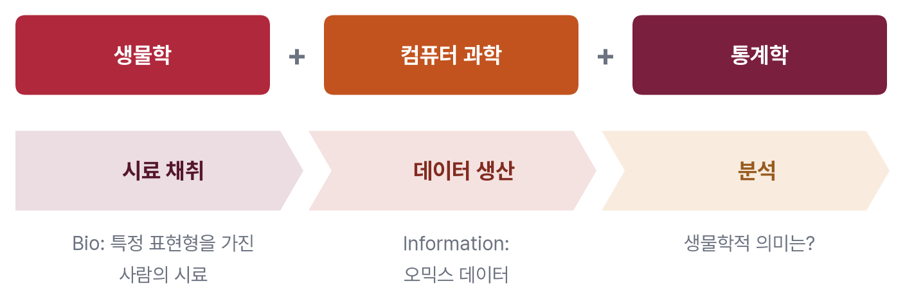

    Bio ➡️ 사람의 시료 (특정 표현형을 가진)

    Information ➡️ 데이터 (오믹스, Omics)

------------------------------------------------------------------------

### 차세대 염기서열 분석 (Next generation sequencing, NGS)

오믹스 데이터는 NGS로 생산됩니다.

**생어 염기서열 분석(Sanger Sequencing)** 과 **차세대 염기서열 분석(NGS)** 의 차이는 무엇일까요?

-   Sanger sequencing ... **형광 표지된 ddNTP**

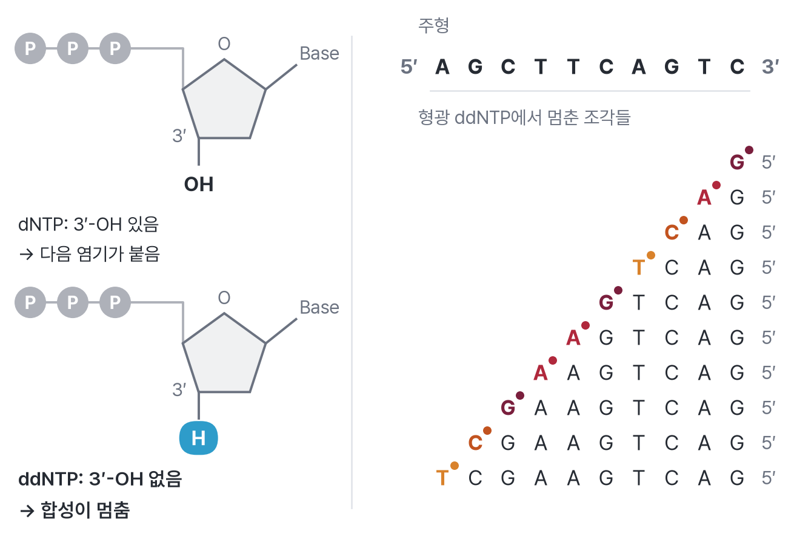{fig-align="center"}

------------------------------------------------------------------------

-   **NGS**: 라이브러리 제작(library preparation) + 합성에 의한 염기서열 분석(sequencing by synthesis)

    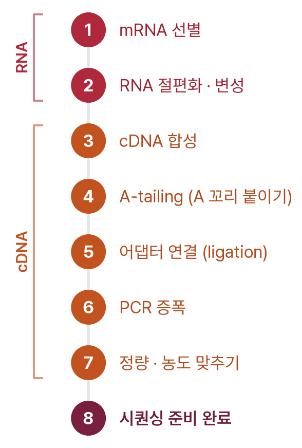{fig-align="center" width="255"}

------------------------------------------------------------------------

-   라이브러리 제작 & 브리지 증폭(bridge amplification)

    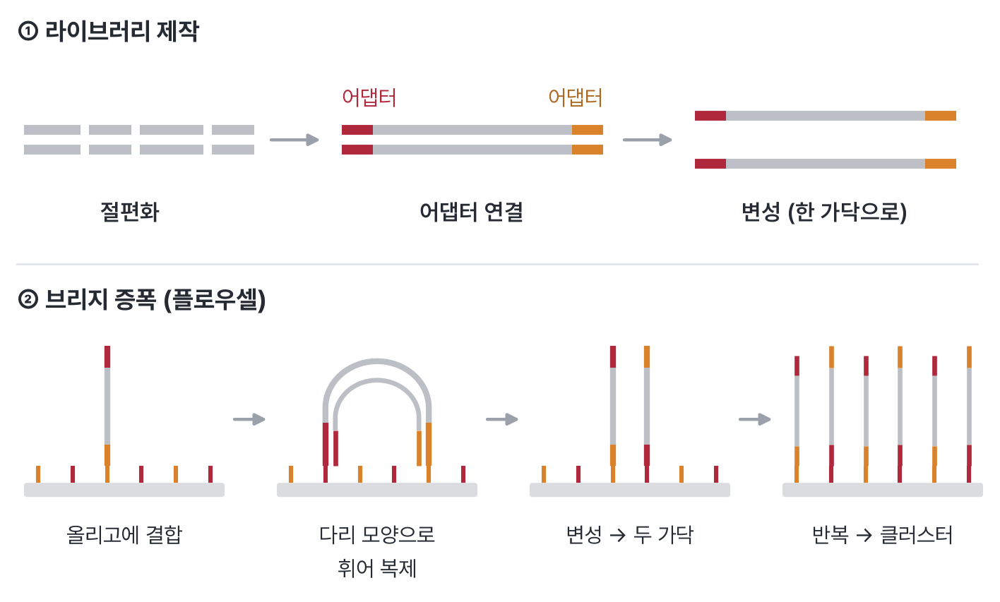{fig-align="center"}

------------------------------------------------------------------------

-   합성에 의한 염기서열 분석 (sequencing by synthesis, SBS)

    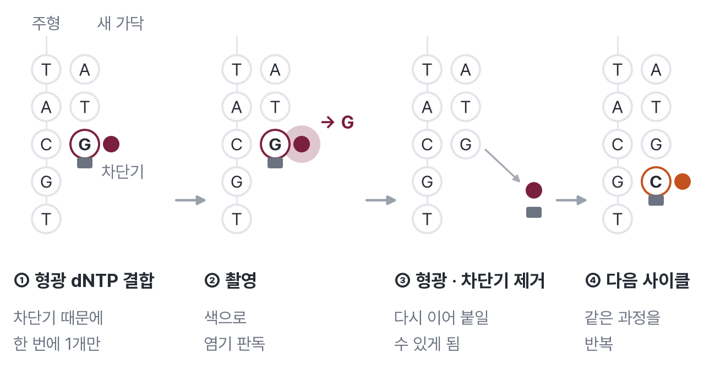{fig-align="center"}

    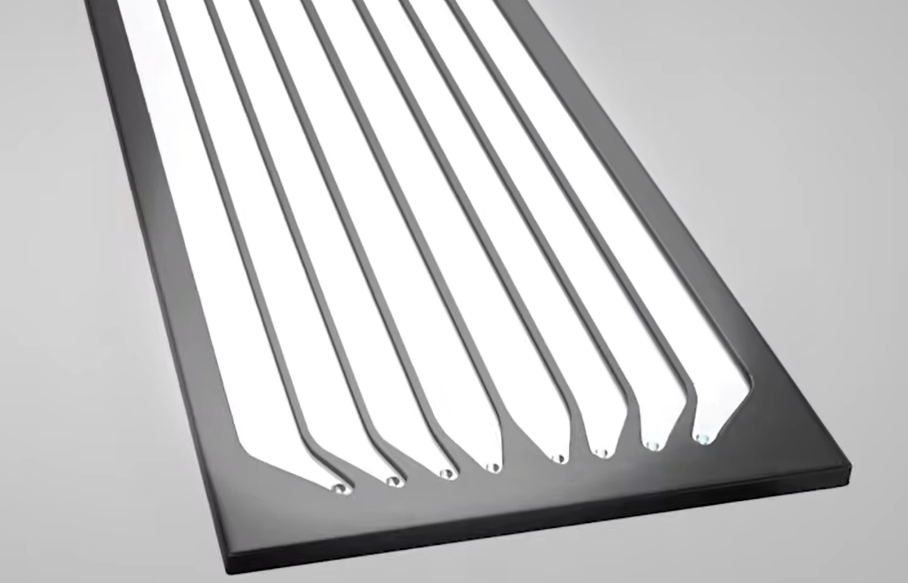{fig-align="center" width="233"} 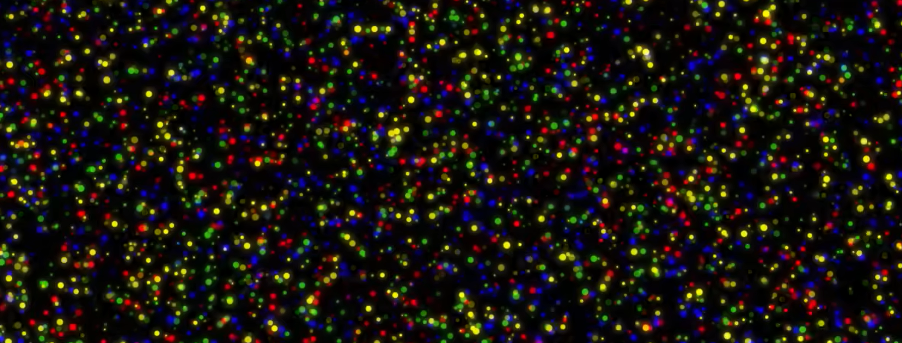{fig-align="center" width="393"}

------------------------------------------------------------------------

-   NGS 라이브러리 분자: 어댑터(adapter) + 삽입체(insert)

    -   P5/P7 (플로우셀에 결합)
    -   Index (시료 식별자, 6–12 nt, 다중화(multiplexing)용)
    -   Primer (예: mRNA용 PolyA, total RNA용 6-mer)

    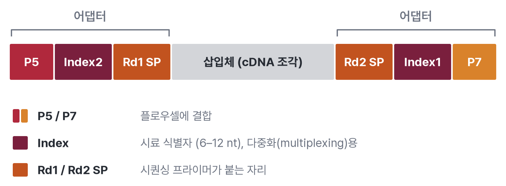{fig-align="center"}

------------------------------------------------------------------------

#### 단일 말단(Single-end) vs. 양 말단(Paired-end) 시퀀싱

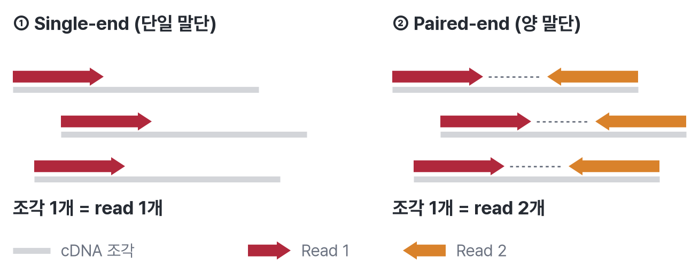

------------------------------------------------------------------------

#### 3' kit vs. 5' kit (mRNA 포집용)

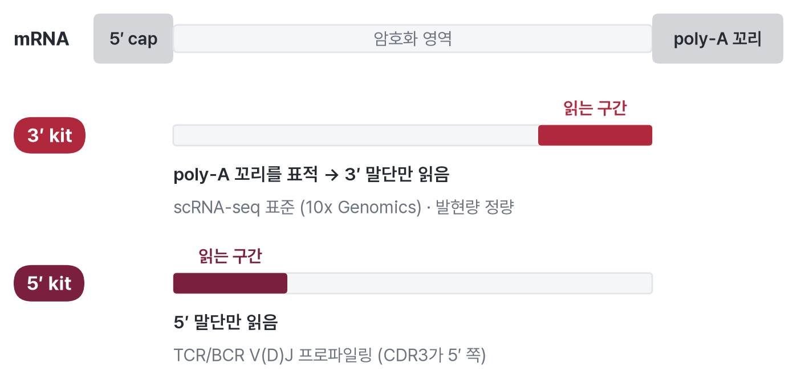{fig-align="center"}

**3' kit가 흔히 쓰이는 이유:**

-   **scRNA-seq 표준:** 10x Genomics Chromium은 3' kit를 표준으로 사용
-   비용 효율적이고 처리량이 높음
-   유전자 발현량 정량에 충분함
-   poly-A tail을 표적하므로 mRNA 포집 효율이 높음

**5' kit를 쓰는 경우:**

-   **TCR/BCR V(D)J 프로파일링:** CDR3 영역이 5' 말단에 위치
-   T 세포·B 세포 레퍼토리 연구에 필수
-   보통 10x Genomics 5' kit와 V(D)J enrichment를 조합해 사용

------------------------------------------------------------------------

### 오믹스(Omics) 데이터

-   전체론적(holistic) & 포괄적(comprehensive)
-   고차원 … large p, small n
-   다층적·계층적 구조 … 중심 원리(central dogma)

#### FASTQ 형식

-   서열 정보
-   read 하나당 네 줄 (n = 20\~30M)

```         
@SRR21484222.626.1 626 length=51       ← Read ID
GCCTTGGTGGTGAAATGGTAGACTGGAATTCTCGGGTGCCAAGGAACTCCA  ← Sequence
+SRR21484222.626.1 626 length=51       ← Description
F:FFFFFFFFFFFFFFFFFFFFFFFFFFF:FFFFFFFFFFF:,FFFFFFFFF  ← Base call quality (Phred score)
```

#### Phred 품질 점수 (Phred Quality Score)

$Q = -10 \log_{10} P$

| Phred 점수 | 오류율      | 염기 판독 정확도 |
|------------|-------------|------------------|
| 10         | 1 in 10     | 90%              |
| 20         | 1 in 100    | 99%              |
| 30         | 1 in 1,000  | 99.9%            |
| 40         | 1 in 10,000 | 99.99%           |

------------------------------------------------------------------------

### 중심 원리 (Central Dogma)

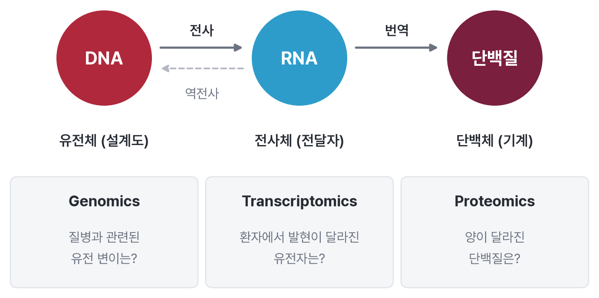

> 이 수업에서는 [전사체(transcriptome)]{.underline} (RNA-seq 데이터)에 집중합니다

------------------------------------------------------------------------

### 왜 생물정보학인가?

✅ NGS 실험 한 번 ➡️ GB에서 TB 규모의 정보 … 전통적인 실험실 방법으로는 감당할 수 없는 양

✅ 빠르게 낮아지는 NGS 비용 ➡️ 기하급수적으로 늘어나는 데이터

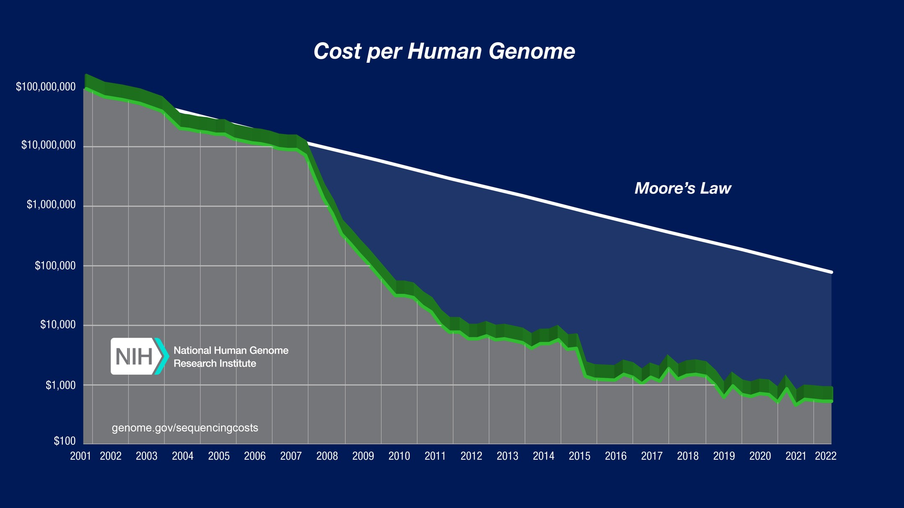{fig-align="center" width="749"}

------------------------------------------------------------------------

## 2. Bulk RNA-seq 데이터

조직 내 수백만 개 세포의 **평균** 유전자 발현 수준을 측정하는 기술

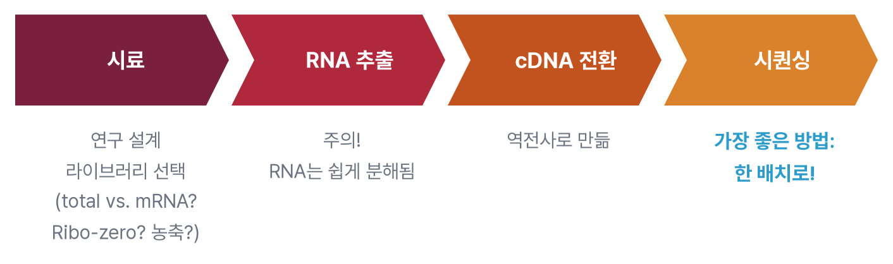

------------------------------------------------------------------------

## 3. R & RStudio

#### 임상 연구자의 일반적인 작업 흐름 (?)

```         
Excel에서 데이터 정리 → SPSS에서 분석 → 결과를 Word에 복붙 → 리뷰어 코멘트 → 처음부터 다시...
```

::: callout-warning
## 이 방식의 단점

-   데이터가 갱신되면 → 모든 표와 그림을 손으로 다시 만들어야 함
-   "이 p-value는 어디서 나온 거지?" → 추적하기 어려움
-   공동연구자와 분석 공유 → 말로 설명하거나 스크린샷
:::

------------------------------------------------------------------------

#### 왜 R인가?

✅ Excel을 넘어서는 폭넓은 통계

✅ 무료 & 오픈소스 \>\> SPSS

✅ 논문 게재 수준의 시각화

✅ 생물학·의생명 패키지

------------------------------------------------------------------------

### 1) R 설치

[The Comprehensive R Archive Network (CRAN)](https://cran.r-project.org/)

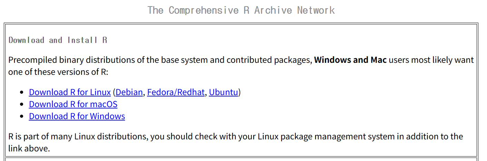{fig-align="center"}

------------------------------------------------------------------------

### 2) RStudio 설치

> R용 IDE (통합 개발 환경, Integrated Development Environment)

[RStudio Desktop - Posit](https://posit.co/download/rstudio-desktop/)

### 3) RStudio 화면 구성

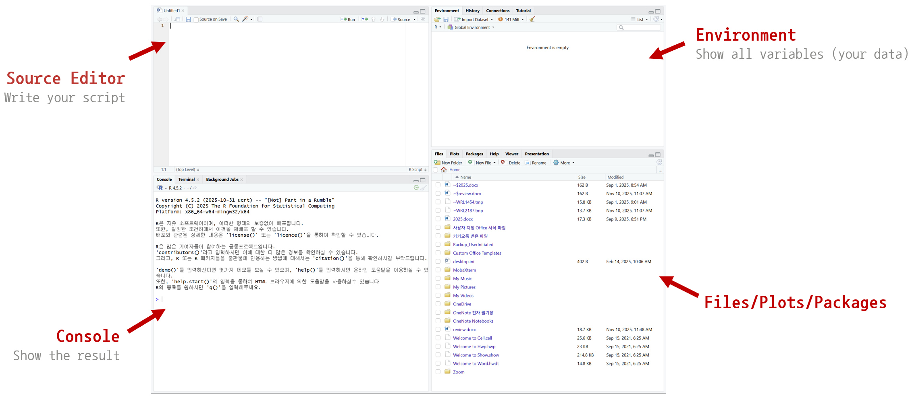{fig-align="center"}

------------------------------------------------------------------------

## 4. R 기초

#### R을 계산기로 사용하기

::: {.cell}

```{.r .cell-code}
2 + 2
```

::: {.cell-output .cell-output-stdout}

```
[1] 4
```

:::

```{.r .cell-code}
10 / 3
```

::: {.cell-output .cell-output-stdout}

```
[1] 3.333333
```

:::

```{.r .cell-code}
5 * (4 - 1)
```

::: {.cell-output .cell-output-stdout}

```
[1] 15
```

:::

```{.r .cell-code}
2^3
```

::: {.cell-output .cell-output-stdout}

```
[1] 8
```

:::
:::

#### 변수에 데이터 할당하기 (데이터에 이름 붙이기)

::: {.cell}

```{.r .cell-code}
x <- 10
y <- 5
x + y
```

::: {.cell-output .cell-output-stdout}

```
[1] 15
```

:::

```{.r .cell-code}
x * 2
```

::: {.cell-output .cell-output-stdout}

```
[1] 20
```

:::
:::

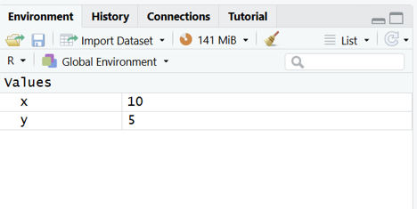{fig-align="center"}

------------------------------------------------------------------------

## 📝 1주차 과제

1.  본인 노트북에 R과 RStudio 설치하기
2.  사칙연산(+, -, \*, /) 연습하기
3.  A에 100, B에 50을 할당한 뒤 콘솔에서 두 값의 합 계산하기

> 화면 캡처(스크린샷)를 제출해 주세요

------------------------------------------------------------------------

## 참고자료 {.smaller}

#### NGS

[NGS vs. Sanger](https://www.illumina.com/ko-kr/science/technology/next-generation-sequencing/beginners/advantages/ngs-vs-sanger.html)\
[NGS Instead of Sanger Sequencing](https://youtu.be/7AHTXT4Y4rU)\
[NGS introductioin](https://www.youtube.com/watch?v=CZeN-IgjYCo)\
[Sequencing by Synthesis](https://www.youtube.com/watch?v=fCd6B5HRaZ8)

#### 오믹스 데이터

[FASTQ](https://en.wikipedia.org/wiki/FASTQ_format)\
[Phred score](https://en.wikipedia.org/wiki/Phred_quality_score)\
[cost of DNA-seq](https://www.genome.gov/about-genomics/fact-sheets/DNA-Sequencing-Costs-Data)

#### RNA-seq

[RNA-seq workflow](https://www.illumina.com/techniques/sequencing/ngs-library-prep/rna.html)\
[RNA library prep (illumina)](https://www.illumina.com/products/by-type/sequencing-kits/library-prep-kits/stranded-total-rna-prep.html)
